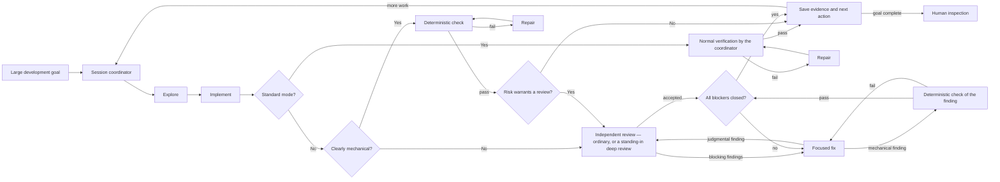

# Autonomous Mode: durable project work

Use `/work` for everyday tasks. The `autonomous` skill is the advanced workflow
for projects and milestones that must continue across many rounds and fresh
sessions. See the [quick start](../README.md) for installation.

## Autonomous Mode

`autonomous` is a skill, not a selectable profile. Invoking it makes the
current session the coordinator: the session follows an explicit process, chooses
one verifiable slice at a time, gives each fresh child a focused context, enforces
budgets and review gates, and saves the evidence and next action in the
repository. There is no separate orchestration service calling model APIs or
shuffling messages between agents, and no `AgenticAle Autonomous` agent to pick.
On OpenCode, when the installation configures a coordinator model, the
`/autonomous` command entry — including a fresh resume — runs in the current
session on the generated `agenticale/coordinator` profile from the first turn;
without one, the invoking session coordinates on its own model.



The high-volume work can run on inexpensive or local models while stronger
models are reserved for difficult implementation, independent review, and
stuck decisions. Every role is configurable, so the workflow can use the
models available through your subscriptions, providers, or local setup.

Exploration, implementation, review, fixes, and escalation are separate jobs
with separate contexts, more like a small development team than one
long-running chat.

The agent that writes a change does not mark its own work. In strict mode a
clearly mechanical change closes by its deterministic check run by the
coordinator, with an independent review only when a visible risk warrants it,
and every other change is reviewed by a fresh agent — an ordinary review, or
a deep review standing in for the slice's own gate where its risk warrants an
integration-level audit, whose verdict is the slice's gate. In standard mode
the slice's gate is the coordinator's normal verification. A failed
deterministic check or failed standard-mode verification is repaired and the
same gate is re-run by the coordinator — it does not enter the review-finding
loop, because no reviewer ran — while a review's blocking findings go through
a focused fix whose closure follows the finding's class, not the fix's
appearance: a mechanical finding closes by the deterministic
check, while a judgemental finding — a behaviour, correctness, or design
finding — takes an independent re-review of the fix and the invariants it
touched, even when the repairing edit is a simple mechanical change. When a
review reports several blocking findings, every blocker must close before the
slice is accepted — a passing check alone never accepts while another
blocker remains open. The
loop is bounded by the run's worker budgets and progress safeguards, not a
fixed per-target cycle count. Each accepted round leaves compact durable
evidence so another agent or a later session can continue without
reconstructing the plan from chat history.

## Why use Autonomous Mode?

Autonomous Mode is useful when a task is too large or too easy to lose track of
for a single chat, for example:

- adding a feature across several files;
- upgrading or refactoring an existing project;
- investigating a bug and implementing the fix;
- making a series of changes while keeping verification visible.

It is designed around a simple cost and quality strategy:

- use a fast, inexpensive, or local model for most exploration and routine
  implementation;
- use a stronger model only for difficult reasoning, independent review, or a
  stuck decision;
- keep the context for each round small, so models spend less time rereading
  the entire project;
- preserve the next action on disk, so an interrupted session does not lose the
  plan.

A new run commits and pushes each completed task by default: after the
task's required checks and review gates pass, the coordinator makes coherent
task commits and confirms an ordinary push before the next task starts. Say
**commit only** or **leave changes uncommitted** to restrict the run —
explicit user or repository restrictions win, are recorded with their basis,
and are never bypassed; a resume keeps the recorded policy. Branch creation,
opening a PR, merging, force-pushing, and changing remotes remain separate
explicit requests. The workflow works on the currently checked-out branch
and asks before pushing to a main, protected, or ambiguous destination.

## How the workflow works

For implementation work, including a single-task goal, each slice is followed
by its applicable gate: a review round — ordinary, or a standing-in deep
review where the slice's risk warrants an integration-level audit — or, for a
clearly mechanical slice, the coordinator-run deterministic check; in
standard mode, the normal verification. Blocking findings are sent to a
focused fix round before work advances; a failed deterministic check or
standard-mode verification is repaired and the same gate is re-run. The
coordinator keeps investigation-only work or explicitly low-risk mechanical
tasks lighter only when a full review gate would not add useful value. The workflow records durable state in `BACKLOG.md` and
the compact snapshot `.agenticale/active.md` in the project being worked on.

For a complex bounded goal, the coordinator may outline a few provisional,
dependent outcomes and complete them in sequence. It reassesses the next slice
after each result, including results from exploration or consultation. A failed
experiment is evidence for revising the plan, but its changes must be reconciled
before implementation advances. The task's allowance, the run ceiling, review
limits, and stop conditions continue across replanning; the accumulated work
still gets combined acceptance checks before delivery.

If the host reports a provider usage quota, Autonomous Mode records the evidence,
retry time, affected role, partial progress, and next action in the snapshot.
The initial quota failure sets the no-work retry rejection count to
zero. It waits about 30 minutes by default (or longer when reliable reset
metadata requires it) and resumes from the inspected working tree. Up to eight
automatic cooldown retries may follow the initial failure; eight rejected
retries without resumed progress end in a resumable stop. A fresh activation
preserves this count, and only resumed material progress resets it.
Automatic wake is available only when the current host exposes a supported
wait; otherwise the snapshot keeps the exact retry time for a later session.

## Permissions for unattended runs

The OpenCode installer leaves `opencode.jsonc` unchanged. For unattended runs,
the foreground agent must be able to load the `autonomous` skill and launch the
generated `agenticale/*` profiles, and child actions must resolve as `allow` or
`deny` rather than waiting for approval. Configure this in the global file
(`~/.config/opencode/opencode.jsonc`) or the project file (`opencode.jsonc` or
`.opencode/opencode.jsonc`). See the [OpenCode V2
permissions guide](https://opencode.ai/v2/docs/permissions) for the rule
syntax.

> [!WARNING]
> **Disposable coding environment only.** The example below grants broad read,
> edit, shell, and external-directory access. It can perform destructive
> actions and must not be copied unchanged onto a workstation or a host with
> valuable data. Use it only in a dedicated disposable coding environment or
> container, and adjust the rules to your environment and risk profile.

For example, an isolated container might start with:

```jsonc
{
  "$schema": "https://opencode.ai/config.json",
  "permissions": [
    { "action": "read", "resource": "*", "effect": "allow" },
    { "action": "glob", "resource": "*", "effect": "allow" },
    { "action": "grep", "resource": "*", "effect": "allow" },
    { "action": "skill", "resource": "autonomous", "effect": "allow" },
    { "action": "skill", "resource": "pull-request-description", "effect": "allow" },
    { "action": "skill", "resource": "source-code-lookup", "effect": "allow" },
    { "action": "subagent", "resource": "agenticale/*", "effect": "allow" },
    { "action": "edit", "resource": "*", "effect": "allow" },
    { "action": "shell", "resource": "*", "effect": "allow" },
    { "action": "external_directory", "resource": "*", "effect": "allow" },
    { "action": "external_directory", "resource": "~/.ssh/*", "effect": "deny" },
    { "action": "external_directory", "resource": "/mnt/*", "effect": "deny" },
    { "action": "edit", "resource": "/etc/*", "effect": "deny" }
  ]
}
```

Adjust the action and folder rules to your environment, risk profile, and the
directories your work actually needs. The installed child profiles already
deny interactive questions and nested subagents. If your configuration carries
a pre-rename `autonomous/*` `subagent` rule, update it to `agenticale/*`:
after a profile refresh the generated profiles live under the new namespace,
so the old rule no longer matches them.

**Approval/resume warning:** Some OpenCode V2 builds can leave a child unable
to resume after you manually approve an action. Pre-allow or pre-deny the
actions needed by child sessions; if one stalls after approval, rerun
`/autonomous` to continue from the snapshot.

## Start or resume a goal

Open your project in OpenCode and run:

```text
/autonomous <describe the goal you want completed>
```

For example:

```text
/autonomous Add CSV export to the reports page, update the tests, and verify the result.
```

Use a small round budget when you want tighter control:

```text
/autonomous 3 <goal>
```

When a run is active, `/autonomous` resumes the next action. The default
run ceiling for a new run is 240 worker rounds — a generous emergency safety
limit, not a work target: the run processes eligible backlog tasks until the
backlog is drained or a safety limit is reached. A numeric budget sets an
exact run ceiling; on a resume it changes the ceiling only — the persisted
consumed counters carry over, so `/autonomous 3` after five consumed rounds
leaves the run budget-exhausted rather than silently resetting the count.

Goal text supplied while a run is active steers the run rather than
conflicting with it: explicit new outcomes are decomposed into new backlog
tasks, and continuation instructions adjust the existing plan at the next
selection boundary. The run identity, consumed counters, budgets, and review
gates are preserved, and the active work is never overwritten; an ambiguous
request to discard or replace the active goal asks before rewriting state.
The invocation text never enters the human-owned steering surface.

## How planning and continuation work

Autonomous Mode manages a small operational backlog for you, but it deliberately
advances only one concrete slice at a time:

- `BACKLOG.md` is the durable operational board (soft target ≤ 15–20 KiB;
  compact or split future unstarted milestones around ~25–30 KiB so it stays
  well below host read truncation, using clean multi-line Markdown rather than
  packing history onto single lines). It holds the run identity and limits in
  a short header (overwritten in place, never a chronological stop/resume
  diary), open tasks with dependencies and concise acceptance, compact
  resumable packets for deferred unfinished tasks (carrying each deferred
  task's own counters, still-open items, and next step — deleted on resume or
  close), 1-line `[x]` confirmed result receipts for completed tasks (date,
  outcome, commit hashes, push destination, and any accepted known
  limitations), from which the completed-task count is derived, and a 1-line
  `NEXT` pointer naming the active task ID. It never mirrors the active task's
  counters or working state — those live once in the snapshot.
- `.agenticale/active.md` is the live working checkpoint for the active task
  only (soft target ~2–4 KiB, expanding temporarily when a complex slice has
  many open findings and compacting around ~6–8 KiB). It records the goal,
  established facts, current state (including the single budget line: run
  identity, ceiling, consumed; active task, allowance in force, consumed;
  pending-dispatch note while a charged child is in flight; tree/WIP/gate
  state), currently open findings/blockers (location, defect, required outcome),
  acceptance checks, `TRIED` on reset, and one `NEXT` action. It is overwritten
  in place on every round settle so closed findings and applied or superseded
  fix instructions are deleted immediately.
- Completed tasks collapse to 1-line `[x]` receipts on close (all in-flight
  working notes, scope notes, and fix specs are deleted); prior completed
  milestones may be pruned or collapsed to a 1-line summary at run or milestone
  close. The run creates no default archive, no append-only log file, and no
  round journal — Git history of state-only commits is the audit trail, and
  historical material stays untouched. Unresolved findings become open backlog
  items. A deferred unfinished task keeps its resumable packet in the backlog
  and is never recorded as completed.
- `.agenticale/steering.md` is the optional human-owned steering file (see
  [Live steering](#live-steering)); it is absent by default, and the
  coordinator reads it but never writes it.

A run may carry the legacy layout: `.agenticale/handoffs/active.md` as the
active packet and a human-owned `## Steering` section in `BACKLOG.md`. On
resume, when the new snapshot is absent, the coordinator first establishes
from the backlog and Git whether the run already migrated or closed; a
migrated or closed run never re-imports the legacy packet's stale counters.
Only a run with no migration or closure trace takes the one-time transition,
carrying the recorded identities, consumed counters, allowances in force,
fix/review counters, open gates, and persistence policy exactly into the new
compact snapshot — no reset, no re-derivation — persisted as a bounded
state-only checkpoint before further dispatch. The legacy file itself is
historical material: never auto-edited, migrated away, or deleted. When both
packets exist, a valid new snapshot wins. A torn or missing packet — new or
legacy — rebuilds only from verified prior evidence, or stops naming the gap.

Use the command to start a goal or resume an active run.

Start a new goal:

```text
/autonomous Add CSV export to the reports page, update the tests, and verify the result.
```

Continue work that was interrupted or stopped earlier:

```text
/autonomous
```

That resumes the exact `NEXT` action in `.agenticale/active.md`. Use
`/autonomous 3` to set the run ceiling to three worker rounds; the persisted
consumption carries over, so the remaining budget is the new ceiling minus
what the run already used (never a silent reset).

To start from a prepared backlog, supply goal text that points to the milestone,
such as `/autonomous Deliver the CSV export milestone in BACKLOG.md`. See
[Prepare a backlog for Autonomous](skills/autonomous/index.md#prepare-a-backlog-for-autonomous)
for an example and an instruction you can give a planning agent.

## Budgets: run ceiling, task allowance, and completed-task limit

Every run has two durable worker-round budgets and a separate completed-task
limit:

- The **run ceiling** defaults to 240 worker rounds — the emergency safety
  limit — or the positive integer supplied at invocation. The coordinator
  never auto-grows it; an explicit ceiling is exact, and a larger ceiling is
  an explicit numeric override or a named user grant.
- Each genuine task has its own **task allowance** of 12 worker rounds with
  the shared progress-based hard ceiling of 24: when the normal allowance is
  reached with verified progress evidence, the coordinator records a bounded
  extension up to that ceiling before dispatching further worker rounds —
  automatically, without a permission ask, and never on code churn. It is
  independent of the run ceiling and of the Work preference file's `## Work`
  allowance. An explicit user task limit or the boundary of a named grant is
  an exact cap that never auto-extends; only a named user grant extends a
  specific task's allowance beyond its ceiling.
- The **completed-task limit** defaults to 20 completed tasks per run. A task
  counts only after its task persistence gate is fully satisfied, including
  the bounded state finalization; deferred, blocked, exhausted, review-open,
  and WIP-checkpointed tasks never count. Reaching the limit while eligible
  backlog work remains is an INCOMPLETE safety stop, never a completed run.
  An explicit user instruction may set a different limit; it never
  auto-grows.

Every explore, implement, and fix round is charged once to both the current
task and the run; the effective remaining worker budget is the smaller of the
task's remaining allowance in force and the run's remaining ceiling. Review,
review-deep, and consult rounds keep their own accounting and consume neither
worker budget. Only a genuinely new task receives a fresh allowance:
decomposition, replanning, resume, and interruption recovery keep the same
task identity, consumed counters, and any recorded progress extension. A
progress extension is a recorded allowance increment backed by verified
progress evidence, never a reset; a replay of productive work keeps its
recorded charge.

Productive fix continuation is bounded by that effective worker budget,
verified progress evidence, and the stall safeguards — not by per-target
fix/review cycle counts (the historical two-fix/three-review and two-re-audit
defaults are not authorization gates in either workflow). While at least one
effective worker round remains, the latest fix made verified progress, and
the autonomy envelope holds, the coordinator continues the fix → verify →
re-review loop unattended — including a fourth or later productive fix within
budget, with no repeated prompts to authorize one more target cycle. Every
review needs changed slice or fix evidence, a required integration gate,
bounded interrupted-review recovery, or an explicit user request — which
authorizes one bounded audit over the range the user names: the request is
itself the justification, so it authorizes that audit, not a review-only
loop; review-only loops over unchanged evidence are prohibited. Fix and
review counters persist as per-target evidence across resumes, replans,
and renames, with no reset or
re-identification; counts recorded under the historical default caps are
retained as evidence but never re-gate a resumed run, while an explicit user
limit recorded in the durable state stays binding and never auto-extends.
Two consecutive worker rounds with no verified progress, the same blocker two
rounds in a row, the repeated-interruption limit, and the invariant-replanning
rules stop the loop regardless of remaining budget. When the budget is
exhausted, no further fix runs, but the required review of the last allowed
worker — including the deep re-review of a last allowed judgmental fix —
still runs at zero worker rounds: the budgets gate fix dispatch, not review.
Surviving blockers keep the target incomplete and review-open; an exhausted
run ceiling or completed-task limit stops the run as an INCOMPLETE safety stop
whenever eligible work remains, with the named increment a continuation
needs, while an exhausted task allowance alone defers the target and the run
continues with another truly independent ready task when one can be selected
safely. Consults remain capped at one per decision and two per session and
cannot grant worker budget; the session still runs at most one additional
opportunistic deep review escalation — the post-gate deep reviews: the
struggle trigger, which fires at two or more fix rounds made in response to
a review round's findings on a slice (it fires whether or not a later pass
eventually passed), and an explicit user request — while a
deep review standing in for a slice's own gate is that slice's required gate
review, outside the cap, and you may always explicitly direct an additional
escalation.

Round 0 records a stable run identity, the run ceiling, and the completed-task
limit; every task receives its stable ID
(`T1`, `T2`, … in recording order) when it enters the backlog, before any
selection, so steering can name never-selected tasks. The fresh allowance is
allocated only at a genuinely new task's first selection. The ID travels
through the backlog, the snapshot, dispatch records, and the result records.

Counter and state-transition bookkeeping is consolidated in the skill's
**state protocol** — one authoritative procedure for five events:
**charge** (the durable, read-back-verified pre-launch snapshot write of both
counters, the dispatch record, and the pending note, before the child
launches), **settle** (resolve the pending note and record the compact
outcome — the current state and evidence the next round needs stay in the
snapshot, the settled result folds into the backlog task's result/progress
note; a productive round keeps its single charge, a quota-only
or never-launched dispatch removes it, and a continuation is a new round
with its own charge), **switch** (the outgoing deferred packet durable in
the backlog before the snapshot is overwritten), **reconcile** (at every
launch and fresh resume: validate the complete snapshot before trusting any
counter, let a validated snapshot win over a duplicate deferred entry,
rebuild a torn or missing snapshot only from verified prior Git and host
evidence — never from a ledger or memory — or stop naming the gap, and
resolve a pending dispatch exactly once against the actual
evidence), and **finalize** (the one bounded state-only sequence that
confirms a persistence boundary: record writes, one state-only commit,
confirmed push, read-only acknowledgment, never the commit's own hash).
Every other section names the event it applies instead of restating the
procedure. The snapshot's budget line is the single counter authority for
run consumption and the active task's counters — including the allowance in
force with any recorded progress extension; the backlog never mirrors them,
and is canonical for the run identity and limits, deferred packets, which
carry task counters only — never a run-consumption snapshot — and the
confirmed result records. The completed-task count is derived from the
backlog's confirmed result records, never from a separate tally that can
drift.

The protocol is instruction-level: the coordinator model executes it with
ordinary targeted file edits and Git commands. No host guarantees a shared
script runtime or atomic file writes, so the safety comes from the targeted
writes on fresh re-reads, the read-back before the next step, and validation
before trust — not from a helper process. A crash, a torn write, an
interrupted task switch, or a quota-only launch rejection never double
charges, replays productive work for free, or restores stale run consumption.
A resume — the same `/autonomous` command — runs reconcile first and
continues the exact unfinished action the validated state's one `NEXT`
names; a numeric resume override changes the ceiling only.

An exhausted task allowance is not a run stop: the allowance in force is
exhausted at the progress ceiling or an exact explicit cap, with no further
extension justified under the shared contract. No further worker round runs
for that task, and the task is excluded from worker selection until a user
grant extends its allowance — even when steering names it first — while
verification and the permitted review of its completed changes still run
and remain schedulable. The unfinished part stays incomplete with its
findings, current state, and one next action preserved as a resumable
backlog packet. The run may select another truly independent ready task with
a fresh allowance — never bypassing review gates, dependencies, or safety,
and never manufacturing tasks. The run stops for budget only when the run
ceiling or the completed-task limit is exhausted, or when no safe ready work
remains — an incomplete stop whenever unfinished tasks remain, never a
completed run.

## Live steering

The optional human-owned `.agenticale/steering.md` file is the run's small,
documented steering surface — not a general command channel:

```markdown
- mode: continue
- priority: T3, T2
```

The file is absent by default: no file means `continue` and no priority.
`mode: pause` stops the loop at the next safe checkpoint: a running child
settles first, its result and charge are recorded, and the exact `NEXT` and
all counters are preserved before the pause report. Only the exact value
`pause` pauses; an unrecognized value changes nothing and is noted in the
next report. The pause is persistent: it survives session ends and resumes.
A fresh `/autonomous` activation re-reads the surface — `continue` (or an
absent file) resumes the recorded `NEXT`, while a still-present `pause` stops
again without dispatching; only the human's own edit releases it.
`priority` reorders only the next task selection among ready
tasks — never the active task or a running round — and never unblocks a
blocked, dependent, unknown, or allowance-exhausted ID. Tasks carry their
IDs from backlog entry, so a recorded never-selected task can be named.

The coordinator re-reads the surface before every new round dispatch
(workers, reviews, fixes, consults, deep reviews). It never creates, edits,
or deletes the file, and children never touch it. There is no polling,
watcher, or service. Steering grants no allowance, scope, Git right, or gate
exception.

A legacy run may carry the human-owned `## Steering` section in `BACKLOG.md`
with the same two controls. The coordinator reads it when the new file is
absent and never edits it; agent backlog writes are targeted edits on a
fresh re-read, so concurrent human steering edits survive. When both
surfaces exist, `pause` in either pauses the run (pause wins), and
`priority` comes from the new file when it defines one, otherwise from the
legacy section; a disagreement is noted in the next report, and neither
surface is auto-edited to resolve it. The one-time transition is the human's
own act — creating the new file, optionally copying the controls — never the
coordinator's; the legacy section stays untouched as history.

## Model routing across sessions

`autonomous` uses the same model configuration and shared routing policy as
`work`. On OpenCode the models are fixed in the generated agent profiles at
install time; on the other hosts the workflow reads the one optional
preference file (project first, then personal) at most once per activation.
There is no tier system and no routing bootstrap: the workflow never selects
a model itself, and an unconfigured optional route (`implement-easy`,
`consult-hard`) falls back to its base route with its existing assignment.

- Each round's dispatch record stays in the compact snapshot and the
  backlog's settled task evidence: the task role, the dispatched role
  (including a hard fix on
  `implement-hard`), the task contract it ran, and — only where the active
  binding exposes it — the role's model selection. A child's self-reported
  model name never establishes what it ran on; an unknown selection stays
  unknown.
- A fresh resume re-reads the current installation and reassesses the next
  slice's route against it, reporting material changes before continuing.
  The prior state's dispatch records are diagnostic history, not a route
  lock and not a layer that overrides the current configuration.
- Routing creates no new state and no configuration file: the records live
  in the existing snapshot and backlog task evidence, and the workflow never
  creates or modifies a preference file. See
  [setup and customization](setup.md#customizing-model-routing) for the
  customization path.

## Copilot entry point

There is no coordinator to select: invoke the `autonomous` skill and the current
session coordinates. Start:

```sh
/agenticale:autonomous 3 <goal>
```

`/agenticale:autonomous 3 <goal>` supplies an optional worker-round budget;
`/agenticale:autonomous` resumes the active run. The skill is explicit-only
(disable-model-invocation), so it only runs when you invoke it. The everyday
`work` skill uses session state instead and does not resume autonomous work.

## Review and persistence

Independent review remains the default for changes. The existing standard mode
is retained for investigation-only work or explicitly accepted mechanical work
without an independent review. Accepted slices, open findings, and session
closure remain durable in the compact state: settled tasks collapse to 1-line
receipts in the backlog, `.agenticale/active.md` is pruned on every round
settle, and no default archive or append-only log is created.

A new run defaults to commit and push per completed task. Slices and tasks
are different units: each slice passes its own gate, and the task's
persistence gate runs once, after its required checks, gates, and
applicable deep gates close. Reviews are phase-aware: a slice reviewer
inspects the uncommitted working-tree result and records its verdict, never
requiring the gate's commits or push before the gate has run;
the coordinator owns final persistence verification.
The coordinator owns every commit and push — children leave verified changes
in the working tree — stages only the task's accepted product changes
(preserving unrelated work and secrets), makes coherent task commits, and
confirms an ordinary push to the resolved upstream. It then runs the state
protocol's **finalize** event once: the completion record is
written into the existing state files, committed as a single state-only
commit, and pushed and confirmed under the default policy. The finalization
commit's own hash is never written into the state it commits, and the gate's
local acknowledgment is read-only, so the sequence is finite — no recursive
record-your-own-hash loop — and the task is marked completed and the next
task selected only after the finalization is confirmed. An investigation-only
task creates no artificial product commit, but changed durable findings are
persisted by the same state finalization. When the last task completes and
the goal is met, the consolidated final close carries the run-close record
in the same completion commit, keeping the snapshot as the recovery
checkpoint until that commit's persistence is confirmed; only then does a
separate bounded cleanup fold the remaining state into the backlog's result
records and remove the snapshot, recoverable from git history. An incomplete
stop keeps the snapshot as its resume state. Blocked
persistence — an unsafe destination or a rejected or uncertain push at any
boundary, including a checkpoint — goes directly to the terminal local-only
close: the local records are saved first, no further commits or pushes
follow, all further persistence deferred and
reported as unconfirmed, never completed.

Every task is in exactly one lifecycle state — review-open, accepted,
persistence-pending, complete, or unfinished (deferred, blocked, or
exhausted) — and the state governs selection and accounting: only a
confirmed complete gate permits the next task's selection and counts the
task, exactly once, toward the completed-task limit; a clean review alone
never completes a task. Deferring or blocking the active task opens a
selection boundary only as a documented deferral with a resumable packet —
never a completion bypass — and a WIP checkpoint changes no state.
Reconciliation is replay-safe from the actual local and remote Git
evidence: confirmed steps are recorded, not repeated, and an uncertain push
blocks every descendant persistence until a reconciling resume.

Explicit restrictions select a commit-only or working-tree policy instead,
recorded with a concretely cited basis: an actual user or repository
prohibition, not a conditional "unless explicitly asked" guard (the
invocation satisfies that condition), Work's uncommitted default, the
children's no-commit role boundary, or the coordinator role. The policy and
its basis are stated visibly at start and every fresh resume, with an
explicit warning when accepted work stays uncommitted or unpushed; a legacy
handoff with no recorded policy resumes as working tree with that warning,
never silently upgraded. Resumes keep the recorded policy; an explicit user
change to commit or commit-and-push is recorded with its basis and reconciles
outstanding persistence under the new policy before further dispatch.
Completed tasks are re-evaluated against the new policy — including tasks
already finalized under the former policy, whose gate
satisfaction under that policy does not cover accepted work left
uncommitted or unpushed under the new one. The reopening is persistence-only:
reviews, counters, NEXT, and recorded evidence are preserved, and the
coordinator reconciles it without dispatching children or consuming budget.
The order is fixed and finite: reopened tasks through the task persistence
gate in completion order — reusing existing commits, pushing them as-is
under commit-and-push, and updating the completion record through one
bounded state-only finalization — then the reconciliation checkpoint only
for state no finalization or earlier checkpoint already carried, then any
remaining unpushed run commits pushed as-is. All under the ordinary
destination, scope, and failure rules, never duplicating commits. A failed,
uncertain, or interrupted push preserves the exact persistence state and
stops resumably; a resume reconciles the actual local and remote history —
confirming ancestry or content — before retrying the exact unfinished step,
never duplicating commits, replaying work, or completing a task prematurely.
The policy also governs the run's intermediate persistence boundaries. A
significant reconciliation of the durable plan — added or removed tasks,
rewritten acceptance, reordered upcoming tasks, changed deferred packets —
is persisted as one state-only checkpoint commit, pushed and confirmed
before any further dispatch under the default policy; a significant reorder
is a plan change even when no task's text changes. Routine state and
counter writes are never checkpointed, and a bare human `priority` hint
rewrites no plan and needs no checkpoint. A stop with attributable
unfinished product changes
checkpoints them as explicit WIP commits (one per changed repository,
`WIP:`-identified with the run and task IDs), pushed under the same policy,
with the verification/review status and exact continuation recorded in the
durable state. A WIP checkpoint never completes a task or bypasses its
gates; the task gate later reuses the recorded WIP commits instead of
duplicating them, and the coordinator's own reviews of the task use a range
that starts at or before the recorded pre-WIP base — preserved across
resumes — so the WIP commits are inside the diff. Checkpoints
are coordinator Git actions: they dispatch no children and consume no
budget, follow the same destination, scope, failure, and recovery rules as
task pushes — a blocked or uncertain checkpoint push goes directly to the
terminal local-only close, with no further commits or pushes until a
reconciling resume — and promise nothing when the coordinator itself is
interrupted before reaching them.
Branch creation and opening a PR remain separate explicit requests in this
advanced workflow; `/work --pr` provides the bundled everyday delivery
endpoint.

The coordinator records read-only exploration and consultation reports on disk;
read-only children never need edit permission to preserve their findings.
