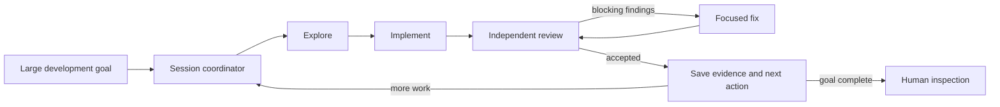

# Autonomous Mode: durable project work

Use `/work` for everyday tasks. The `autonomous` skill is the advanced workflow
for projects and milestones that must continue across many rounds and fresh
sessions. See the [quick start](../README.md) for installation.

## Autonomous Mode

`autonomous` is a skill, not a selectable profile. Invoking it makes the
current session the coordinator: the session follows an explicit process, chooses
one verifiable slice at a time, gives each fresh child a focused context, enforces
budgets and review gates, and saves the evidence and next action in the
repository. There is no separate orchestration service calling model APIs or
shuffling messages between agents, and no `AgenticAle Autonomous` agent to pick.
On OpenCode, when the installation configures a coordinator model, the
`/autonomous` command entry — including a fresh resume — runs in the current
session on the generated `agenticale/coordinator` profile from the first turn;
without one, the invoking session coordinates on its own model.



The high-volume work can run on inexpensive or local models while stronger
models are reserved for difficult implementation, independent review, and
stuck decisions. Every role is configurable, so the workflow can use the
models available through your subscriptions, providers, or local setup.

Exploration, implementation, review, fixes, and escalation are separate jobs
with separate contexts, more like a small development team than one
long-running chat.

The agent that writes a change does not mark its own work. A fresh agent
reviews the result, and blocking findings go through a focused fix and review
loop bounded by the run's worker budgets and progress safeguards — not a
fixed per-target cycle count. Each accepted round leaves a durable handoff so
another agent or a later session can continue without reconstructing the plan
from chat history.

## Why use Autonomous Mode?

Autonomous Mode is useful when a task is too large or too easy to lose track of
for a single chat, for example:

- adding a feature across several files;
- upgrading or refactoring an existing project;
- investigating a bug and implementing the fix;
- making a series of changes while keeping verification visible.

It is designed around a simple cost and quality strategy:

- use a fast, inexpensive, or local model for most exploration and routine
  implementation;
- use a stronger model only for difficult reasoning, independent review, or a
  stuck decision;
- keep the context for each round small, so models spend less time rereading
  the entire project;
- preserve the next action on disk, so an interrupted session does not lose the
  plan.

A new run commits and pushes each completed task by default: after the
task's required checks and review gates pass, the coordinator makes coherent
task commits and confirms an ordinary push before the next task starts. Say
**commit only** or **leave changes uncommitted** to restrict the run —
explicit user or repository restrictions win, are recorded with their basis,
and are never bypassed; a resume keeps the recorded policy. Branch creation,
opening a PR, merging, force-pushing, and changing remotes remain separate
explicit requests. The workflow works on the currently checked-out branch
and asks before pushing to a main, protected, or ambiguous destination.

## How the workflow works

For implementation work, including a single-task goal, each task is followed
by a fresh independent review; blocking findings are sent to a focused fix
round before work advances. The coordinator keeps investigation-only work or
explicitly low-risk mechanical tasks lighter only when a full review gate would
not add useful value. The workflow records durable state in `BACKLOG.md` and
`.agenticale/handoffs/active.md` in the project being worked on.

For a complex bounded goal, the coordinator may outline a few provisional,
dependent outcomes and complete them in sequence. It reassesses the next slice
after each result, including results from exploration or consultation. A failed
experiment is evidence for revising the plan, but its changes must be reconciled
before implementation advances. The task's allowance, the run ceiling, review
limits, and stop conditions continue across replanning; the accumulated work
still gets combined acceptance checks before delivery.

If the host reports a provider usage quota, Autonomous Mode records the evidence,
retry time, affected role, partial progress, and next action in the active
handoff. The initial quota failure sets the no-work retry rejection count to
zero. It waits about 30 minutes by default (or longer when reliable reset
metadata requires it) and resumes from the inspected working tree. Up to eight
automatic cooldown retries may follow the initial failure; eight rejected
retries without resumed progress end in a resumable stop. A fresh activation
preserves this count, and only resumed material progress resets it.
Automatic wake is available only when the current host exposes a supported
wait; otherwise the handoff keeps the exact retry time for a later session.

## Permissions for unattended runs

The OpenCode installer leaves `opencode.jsonc` unchanged. For unattended runs,
the foreground agent must be able to load the `autonomous` skill and launch the
generated `agenticale/*` profiles, and child actions must resolve as `allow` or
`deny` rather than waiting for approval. Configure this in the global file
(`~/.config/opencode/opencode.jsonc`) or the project file (`opencode.jsonc` or
`.opencode/opencode.jsonc`). See the [OpenCode V2
permissions guide](https://opencode.ai/v2/docs/permissions) for the rule
syntax.

> [!WARNING]
> **Disposable coding environment only.** The example below grants broad read,
> edit, shell, and external-directory access. It can perform destructive
> actions and must not be copied unchanged onto a workstation or a host with
> valuable data. Use it only in a dedicated disposable coding environment or
> container, and adjust the rules to your environment and risk profile.

For example, an isolated container might start with:

```jsonc
{
  "$schema": "https://opencode.ai/config.json",
  "permissions": [
    { "action": "read", "resource": "*", "effect": "allow" },
    { "action": "glob", "resource": "*", "effect": "allow" },
    { "action": "grep", "resource": "*", "effect": "allow" },
    { "action": "skill", "resource": "autonomous", "effect": "allow" },
    { "action": "skill", "resource": "pull-request-description", "effect": "allow" },
    { "action": "skill", "resource": "source-code-lookup", "effect": "allow" },
    { "action": "subagent", "resource": "agenticale/*", "effect": "allow" },
    { "action": "edit", "resource": "*", "effect": "allow" },
    { "action": "shell", "resource": "*", "effect": "allow" },
    { "action": "external_directory", "resource": "*", "effect": "allow" },
    { "action": "external_directory", "resource": "~/.ssh/*", "effect": "deny" },
    { "action": "external_directory", "resource": "/mnt/*", "effect": "deny" },
    { "action": "edit", "resource": "/etc/*", "effect": "deny" }
  ]
}
```

Adjust the action and folder rules to your environment, risk profile, and the
directories your work actually needs. The installed child profiles already
deny interactive questions and nested subagents. If your configuration carries
a pre-rename `autonomous/*` `subagent` rule, update it to `agenticale/*`:
after a profile refresh the generated profiles live under the new namespace,
so the old rule no longer matches them.

**Approval/resume warning:** Some OpenCode V2 builds can leave a child unable
to resume after you manually approve an action. Pre-allow or pre-deny the
actions needed by child sessions; if one stalls after approval, rerun
`/autonomous` to continue from the handoff.

## Start or resume a goal

Open your project in OpenCode and run:

```text
/autonomous <describe the goal you want completed>
```

For example:

```text
/autonomous Add CSV export to the reports page, update the tests, and verify the result.
```

Use a small round budget when you want tighter control:

```text
/autonomous 3 <goal>
```

When a handoff is active, `/autonomous` resumes the next action. The default
run ceiling for a new run is six worker rounds. A numeric budget sets the run
ceiling; on a resume it changes the ceiling only — the persisted consumed
counters carry over, so `/autonomous 3` after five consumed rounds leaves the
run budget-exhausted rather than silently resetting the count.

Goal text supplied while a handoff is active steers the run rather than
conflicting with it: explicit new outcomes are decomposed into new backlog
tasks, and continuation instructions adjust the existing plan at the next
selection boundary. The run identity, consumed counters, budgets, and review
gates are preserved, and the active work is never overwritten; an ambiguous
request to discard or replace the active goal asks before rewriting state.
The invocation text never enters the human-owned `## Steering` section.

## How planning and continuation work

Autonomous Mode manages a small operational backlog for you, but it deliberately
advances only one concrete slice at a time:

- `BACKLOG.md` is the project-level board. It holds the current milestone
  with the run identity, ceiling, and consumed counters (mirroring the
  active budget line), open items, decisions that still apply,
  each task's stable ID, worker-round counters, and persistence state
  (commits and confirmed push), the first active
  `Next slice`, compact resumable packets for deferred unfinished tasks, and
  the human-owned `## Steering` section.
- `.agenticale/handoffs/active.md` is the working memory for the current slice. It
  records the goal, evidence, current state (including the compact budget line
  and any pending-dispatch note), acceptance checks, and exactly one
  `NEXT` action for a fresh agent.
- Completed slice details are archived under their stable task IDs with final
  counters, while the backlog keeps a compact status and the next action.
  Unresolved findings become open backlog items. A deferred unfinished task
  keeps its resumable packet in the backlog and is never archived as completed.

Use the command to start a goal or resume an active handoff.

Start a new goal:

```text
/autonomous Add CSV export to the reports page, update the tests, and verify the result.
```

Continue work that was interrupted or stopped earlier:

```text
/autonomous
```

That resumes the exact `NEXT` action in `.agenticale/handoffs/active.md`. Use
`/autonomous 3` to set the run ceiling to three worker rounds; the persisted
consumption carries over, so the remaining budget is the new ceiling minus
what the run already used (never a silent reset).

To start from a prepared backlog, supply goal text that points to the milestone,
such as `/autonomous Deliver the CSV export milestone in BACKLOG.md`. See
[Prepare a backlog for Autonomous](skills/autonomous/index.md#prepare-a-backlog-for-autonomous)
for an example and an instruction you can give a planning agent.

## Budgets: run ceiling and task allowance

Every run has two durable worker-round budgets:

- The **run ceiling** defaults to 6 worker rounds, or the positive integer
  supplied at invocation. The coordinator never auto-grows the default for a
  large goal; a larger ceiling is an explicit numeric override or a named
  user grant.
- Each genuine task has its own **task allowance** of 12 worker rounds,
  independent of the run ceiling and of the Work preference file's `## Work`
  allowance. Only a named user grant extends a specific task's allowance.

Every explore, implement, and fix round is charged once to both the current
task and the run; the effective remaining worker budget is the smaller of the
two. Review, review-deep, and consult rounds keep their own accounting and
consume neither worker budget. Only a genuinely new task receives a fresh
allowance: decomposition, replanning, resume, and interruption recovery keep
the same task identity and consumed counters.

Productive fix continuation is bounded by that effective worker budget, not
by the shared default two fix cycles (three review passes) or two deep
re-audits per target. While at least one effective worker round remains, the
latest fix made real progress, and the autonomy envelope holds, the
coordinator continues the fix → verify → re-review loop unattended — no
repeated prompts to authorize one more target cycle. Every review needs
changed slice or fix evidence, a required integration gate, or bounded
interrupted-review recovery; review-only loops over unchanged evidence are
prohibited. Fix and review counters persist as per-target evidence across
resumes, replans, and renames, with no reset or re-identification; counts
recorded under the legacy default caps are retained as evidence but never
re-gate a resumed run, while an explicit user limit recorded in the durable
state stays binding. The no-progress, same-blocker, and repeated-interruption
safeguards and the invariant-replanning rules stop the loop regardless of
remaining budget. When the budget is exhausted, no further fix runs, but the
required review of the last allowed worker — including the deep re-review of
a last allowed judgmental fix — still runs at zero worker rounds: the budgets
gate fix dispatch, not review. Surviving blockers keep the target incomplete
and review-open; an exhausted run ceiling stops the run with the named
increment a continuation needs, while an exhausted task allowance alone
defers the target and the run continues with another truly independent ready
task when one can be selected safely. Consults remain capped at one per
decision and two per session and cannot grant worker budget; the session
still runs at most one opportunistic deep review escalation, and its struggle
trigger fires at two or more fix rounds on a slice.

Round 0 records a stable run identity; every task receives its stable ID
(`T1`, `T2`, … in recording order) when it enters the backlog, before any
selection, so steering can name never-selected tasks. The fresh allowance is
allocated only at a genuinely new task's first selection. The ID travels
through the backlog, the active packet, dispatch records, and the archive.
The active handoff's budget line is the canonical record of run consumption
and the active task's counters; the backlog mirrors it, and deferred packets
carry task counters only — never a run-consumption snapshot. Charges are
persisted to the handoff before launch, mirrored to the backlog in a fixed
order, and reconciled against the actual evidence on resume: the complete
packet is validated before its counters are trusted, and a torn or
incoherent handoff is rebuilt from the verified backlog mirror — never the
reverse — so a crash, a torn write, an interrupted task switch, or a
quota-only launch rejection never double charges, replays productive work
for free, or restores stale run consumption. A resume continues the
persisted counters; a numeric resume override changes the ceiling only.

An exhausted task allowance is not a run stop: no further worker round runs
for that task, and the task is excluded from worker selection until a user
grant extends its allowance — even when steering names it first — while
verification and the permitted review of its completed changes still run
and remain schedulable. The unfinished part stays incomplete with its
findings, current state, and one next action preserved as a resumable
backlog packet. The run may select another truly independent ready task with
a fresh allowance — never bypassing review gates, dependencies, or safety,
and never manufacturing tasks. The run stops for budget only when the run
ceiling is exhausted, or when no safe ready work remains.

## Live steering

The human-owned `## Steering` section of `BACKLOG.md` is the run's small,
documented steering surface — not a general command channel:

```markdown
## Steering

- mode: continue
- priority: T3, T2
```

`mode: pause` stops the loop at the next safe checkpoint: a running child
settles first, its result and charge are recorded, and the exact `NEXT` and
all counters are preserved before the pause report. `mode: continue` (or an
absent section) is normal continuation; a fresh `/autonomous` activation
re-reads the section and resumes the recorded `NEXT` unless the pause is
still present. `priority` reorders only the next task selection among ready
tasks — never the active task or a running round — and never unblocks a
blocked, dependent, unknown, or allowance-exhausted ID. Tasks carry their
IDs from backlog entry, so a recorded never-selected task can be named.

The coordinator re-reads the section before every new round dispatch
(workers, reviews, fixes, consults, deep reviews) and before every backlog
write. Children never edit it. Agent backlog writes are targeted edits on a
fresh re-read — never a stale whole-file overwrite — so concurrent human
steering edits survive. There is no polling, watcher, or service. Steering
grants no allowance, scope, Git right, or gate exception.

## Model routing across sessions

`autonomous` uses the same model configuration and shared routing policy as
`work`. On OpenCode the models are fixed in the generated agent profiles at
install time; on the other hosts the workflow reads the one optional
preference file (project first, then personal) at most once per activation.
There is no tier system and no routing bootstrap: the workflow never selects
a model itself, and an unconfigured optional route (`implement-easy`,
`consult-hard`) falls back to its base route with its existing assignment.

- Each round's dispatch record stays in the existing handoff and round
  ledger: the task role, the dispatched role (including a hard fix on
  `implement-hard`), the task contract it ran, and — only where the active
  binding exposes it — the role's model selection. A child's self-reported
  model name never establishes what it ran on; an unknown selection stays
  unknown.
- A fresh resume re-reads the current installation and reassesses the next
  slice's route against it, reporting material changes before continuing.
  The prior handoff's dispatch records are diagnostic history, not a route
  lock and not a layer that overrides the current configuration.
- Routing creates no new state and no configuration file: the records live
  in the existing handoff/ledger, and the workflow never creates or modifies
  a preference file. See
  [setup and customization](setup.md#customizing-model-routing) for the
  customization path.

## Copilot entry point

There is no coordinator to select: invoke the `autonomous` skill and the current
session coordinates. Start:

```sh
/agenticale:autonomous 3 <goal>
```

`/agenticale:autonomous 3 <goal>` supplies an optional worker-round budget;
`/agenticale:autonomous` resumes the active handoff. The skill is explicit-only
(disable-model-invocation), so it only runs when you invoke it. The everyday
`work` skill uses session state instead and does not resume autonomous work.

## Review and persistence

Independent review remains the default for changes. The existing standard mode
is retained for investigation-only work or explicitly accepted mechanical work
without an independent review. Accepted slices, open findings, and session
closure remain durable under the existing handoff and archival policy.

A new run defaults to commit and push per completed task. Slices and tasks
are different units: each slice passes its own review gate, and the task's
persistence gate runs once, after its required checks, reviews, and
applicable deep gates close. Reviews are phase-aware: a slice reviewer
inspects the uncommitted working-tree result and records its verdict, never
requiring the gate's commits or push before the gate has run and never
archiving; the coordinator owns final persistence verification and archival.
The coordinator owns every commit and push — children leave verified changes
in the working tree — stages only the task's accepted product changes
(preserving unrelated work and secrets), makes coherent task commits, and
confirms an ordinary push to the resolved upstream. It then runs one bounded
state-only finalization: the completion record and archive are written into
the existing state files, committed as a single state-only commit, and
pushed and confirmed under the default policy. The finalization commit's own
hash is never written into the state it commits, and the gate's local
acknowledgment is read-only, so the sequence is finite — no recursive
record-your-own-hash loop — and the task is marked completed and the next
task selected only after the finalization is confirmed. An investigation-only
task creates no artificial product commit, but changed durable findings are
persisted by the same state finalization. Session-close state writes use the
same bounded finalization: the local records are saved first, and blocked
persistence — an unsafe destination or a rejected or uncertain push at any
boundary, including a checkpoint — goes directly to the terminal local-only
close: no further commits or pushes, all further persistence deferred and
reported as unconfirmed, never completed.
Explicit restrictions select a commit-only or working-tree policy instead;
resumes keep the recorded policy. A failed,
uncertain, or interrupted push preserves the exact persistence state and
stops resumably; a resume reconciles the actual local and remote history —
confirming ancestry or content — before retrying the exact unfinished step,
never duplicating commits, replaying work, or completing a task prematurely.
The policy also governs the run's intermediate persistence boundaries. A
significant reconciliation of the durable plan — added or removed tasks,
rewritten acceptance, changed deferred packets — is persisted as one
state-only checkpoint commit, pushed and confirmed before any further
dispatch under the default policy; routine ledger and counter writes are
never checkpointed. A stop with attributable unfinished product changes
checkpoints them as explicit WIP commits (one per changed repository,
`WIP:`-identified with the run and task IDs), pushed under the same policy,
with the verification/review status and exact continuation recorded in the
durable state. A WIP checkpoint never completes a task or bypasses its
gates; the task gate later reuses the recorded WIP commits instead of
duplicating them, and every review's range starts at or before the recorded
pre-WIP base — preserved across resumes — so the WIP commits are inside the
diff. Checkpoints
are coordinator Git actions: they dispatch no children and consume no
budget, follow the same destination, scope, failure, and recovery rules as
task pushes — a blocked or uncertain checkpoint push goes directly to the
terminal local-only close, with no further commits or pushes until a
reconciling resume — and promise nothing when the coordinator itself is
interrupted before reaching them.
Branch creation and opening a PR remain separate explicit requests in this
advanced workflow; `/work --pr` provides the bundled everyday delivery
endpoint.

The coordinator records read-only exploration and consultation reports on disk;
read-only children never need edit permission to preserve their findings.
