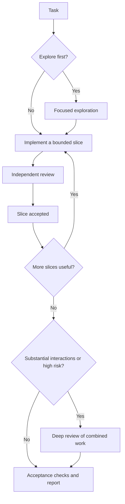
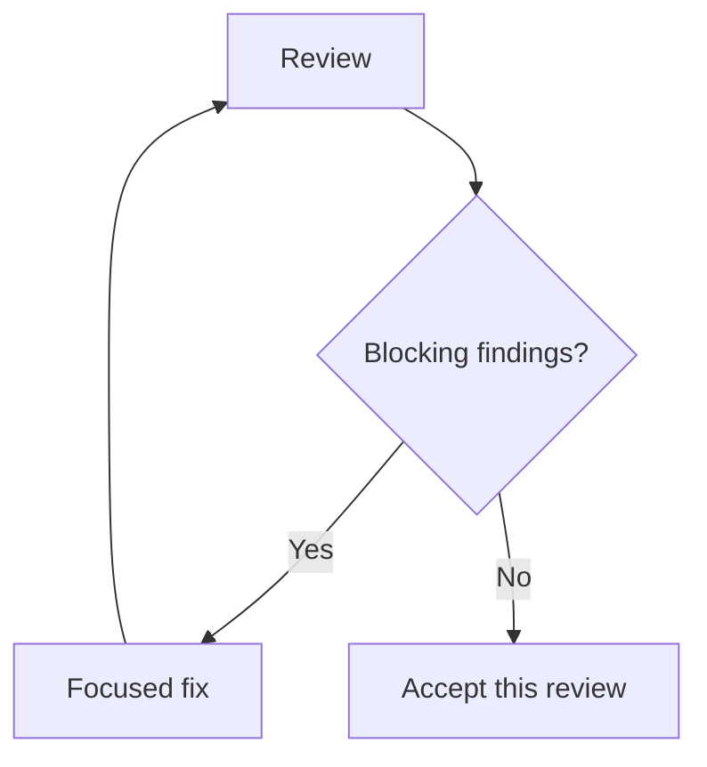

# Work

Work coordinates an everyday coding task through a focused implementation,
independent review, and fixes. It can also handle delivery when you explicitly
request a pull request. Invoke it when you want a change completed and checked
as one task, or when you want feedback on a change already in progress.

## When to use it

Use Work for a bounded feature, bug fix, investigation that should produce a
concrete recommendation, or review feedback on a pull request. It is a good fit
when the task can be divided into clear implementation and review steps.

Examples:

- `/work Fix the date filtering bug`
- `/work Add CSV export for the report table`
- `/work Investigate why export is slow and recommend a fix`
- `/work Address the review feedback on this branch`
- `/work --pr Add CSV export for the report table`

The `/work` examples use conceptual slash syntax. Select the installed skill or
use the client-specific invocation described in [setup](../../setup.md).
Work is explicit-only: an ordinary request to an assistant does not start the
workflow by itself. The session where you invoke it is the coordinator; there
is no separate coordinator agent to choose.

## How a change request moves through Work

The coordinator reads the project instructions and current changes, then sends
a compact task packet to an implementation agent. After implementation, a
different agent reviews the result against the request, project conventions,
and relevant checks. The coordinator assigns a focused fix when the review finds
a defect, then verifies the result and delivers it according to your request.
Exploration is conditional: when a concrete uncertainty needs resolving, Work
can investigate it first; otherwise it proceeds directly to implementation.

Every review uses the same findings gate:

Work allows at most two fix cycles and three review passes per slice or
combined-review target. When a limit is reached with blockers remaining, Work
stops and reports the unresolved blockers.

Each slice passes review before Work moves to the next one. Deep review is an
additional gate when the combined changes have substantial interactions or a
high-risk shared invariant; any blocking findings return through the fix and
review loop. An investigation-only request ends after exploration with findings
and a recommended next step. Work opens a pull request only when you explicitly
request PR delivery; otherwise it reports what it checked and any limitations.

## What to provide

Describe the outcome you want, the relevant behavior, and any constraints that
affect the solution. Include a reproduction, expected result, or acceptance
examples when they clarify a bug or feature. Work reads the current checkout
and any applicable `AGENTS.md` instructions, so point out files or context that
are outside the repository when they matter.

For an investigation, say whether you want a recommendation or an implemented
fix. For pull request delivery, include `--pr` or clearly ask Work to open a PR.
Without that request, changes stay uncommitted in the current branch by default.
Work asks for your input when a meaningful behavior choice is unresolved,
required information is missing, a pull request destination is ambiguous, or
existing user edits overlap the requested change and cannot be safely attributed.

## What you receive

Work returns the implemented change, relevant verification results, and any
remaining limitations. If you request a PR, it prepares the change for review
and returns the PR link. If the task is investigation-only, it returns the
findings and a concrete next step.

## Implementation source

This guide explains the user-facing workflow. The authoritative instructions
are the [Work skill source](https://github.com/alefranz/AgenticAle/blob/main/skills/work/SKILL.md),
[shared round contract](https://github.com/alefranz/AgenticAle/blob/main/skills/work/references/rounds.md),
and [implementation task contract](https://github.com/alefranz/AgenticAle/blob/main/skills/work/references/tasks/implement.md).
Installation remains in the [setup guide](../../setup.md);
architecture and runtime support remain in the canonical
[architecture](../../architecture.md)
and [runtime compatibility](../../runtime-compatibility.md)
references.
