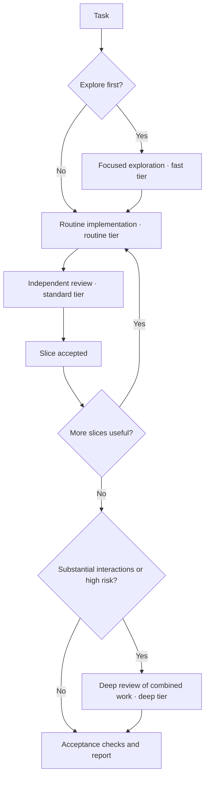
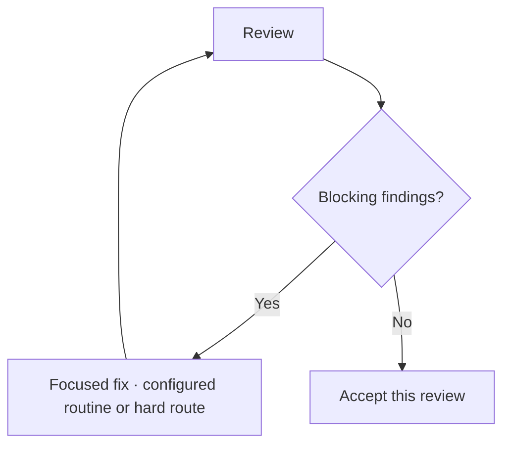

# Work

Work coordinates an everyday coding task through review, focused
implementation, and fixes, optionally delivered as a pull request when you
request it. It can start from a requested outcome, from existing changes —
committed or uncommitted — or from a preceding
[Review](../review/index.md)'s findings in the same session, entering at the
first necessary step: a clear new change is implemented and reviewed, while
coherent existing work is reviewed and fixed directly. Invoke it when you want
a change completed and checked as one task, finished from what is already on
your branch, or feedback on a change already in progress.

Work gives a coding task a clear path from implementation through independent
review, focused fixes, and delivery. A capable lower-cost or local implementer
may need extra focused implementation or fix passes, yet still cost less overall
than using the strongest model throughout. A fresh, stronger reviewer can catch
issues and give actionable feedback; checks and re-review can improve the
result. Added rounds count toward total effort, and savings and quality depend
on the task, models, provider, and account. A fresh reviewer provides
independence; it does not have to use a different model.

Throughout the task, concise progress narration connects the agents' work:
what was learned, what happens next, and why. You can follow the decisions in
the main conversation even when your client collapses the subagent activity.

## Try Work

Invoke the installed skill for a bounded task and describe the outcome you want:

- `/work Fix the date filtering bug`
- `/work Add CSV export for the report table`
- `/work Investigate why export is slow and recommend a fix`

Add `--pr` when you want Work to deliver the finished task as a pull request:
it completes the implementation and its checks, runs the independent review,
makes coherent commits, pushes, and opens the pull request — or updates the
task branch's existing open PR when one already exists. Leading options —
`--pr` (or `--pr=<PR URL>`), `--consult`, `--profile NAME` (or
`--profile=NAME`), `--stats`, and the `--` delimiter — may appear in any order,
with everything after the options as the task text:

- `/work --pr --profile server-b fix the flaky test`
- `/work --consult --pr Redesign the onboarding flow`

You can also start from existing branch changes with an integration-level
audit before any implementation:

```text
/work First perform a deep review of the current branch changes.
If there are blocking findings, fix them, verify the fixes,
then commit, push, and create or update the PR.
Otherwise, report the clean review and stop.
```

The explicit request runs the deep-review contract on the branch's net
changes — the same comparison, scope, and deep-review route as
`/review --deep`, including any selected routing profile — before any
implementation round. Blocking findings go through the normal fix and
re-review loop, and your delivery instructions are honored as written: the
example's clean path reports the review and stops without committing,
pushing, or publishing. A deep review is never started on Work's own
initiative, and the explicit entry adds no flag or general command chaining.

## Continue working on the same PR

Refine the same pull request across invocations. The first request creates it,
a later `--pr` request updates it, and an exact URL targets it from another
chat or checkout:

- `/work --pr Add CSV export for the report table` — creates the pull request
- `/work --pr Tweak the CSV column widths` — updates that same pull request
- `/work --pr=https://github.com/alefranz/AgenticAle/pull/123 Fix the last review comment` — commits and pushes to that exact pull request's head branch

| Request form | Delivery behavior |
| --- | --- |
| `/work <task>` (no options) | Current branch; changes uncommitted by default. |
| `/work --consult <task>` | An independent task-framing consultation runs before implementation; Work then proceeds normally. |
| `/work` (no task) | Selects the task from an unambiguous active task, a preceding same-session `/review`, or coherent existing branch and working-tree changes; asks what to work on when no selection is safe; uncommitted by default. |
| `/work --pr <task>` | Complete, check, review, commit, and push; updates the task branch's open pull request or creates one. |
| `/work --pr` (no task) | The same task selection as an empty `/work`, plus PR delivery for the selected existing work. |
| `/work --pr=<PR URL> <task>` | Commits and pushes to that exact pull request's head branch. |
| Explicit "first perform a deep review of the current branch changes" request | The deep-review contract reviews the branch's net changes before implementation; commits, push, and publication follow the task text's delivery instructions, including conditional ones — the clean path stops without publishing. |

An empty `/work` adopts coherent existing changes — committed or uncommitted,
including a clean feature branch with existing commits — or asks what to work
on. A `/work` that follows a same-session `/review` uses that review's findings
and scope directly, without copying the report or restating the task. The full
task-selection and intent rules are in the
[skill source](https://github.com/alefranz/AgenticAle/blob/main/skills/work/SKILL.md).

Publishing intent is task-scoped: a fresh `/work` without `--pr` does not
inherit a previous task's pull request endpoint, and merely mentioning a pull
request or asking to address its feedback does not publish. A closed, merged,
inaccessible, or ambiguous explicit target is not replaced by a different pull
request — Work preserves the completed work and reports what is needed to
continue.

A selected profile is session-scoped: a fresh activation without a selector
uses ordinary routing. An unambiguous natural-language instruction (for
example, "use the server-b routing profile") selects a profile; merely
mentioning one does not. An unknown, conflicting, or missing profile selector
is reported before dispatch. Named routing profiles are described in
[named routing profiles](../../guides/model-routing.md#named-routing-profiles).

The examples use conceptual slash syntax; select the installed skill or use the
client-specific invocation described in [setup](../../setup.md). Work starts
only when explicitly invoked. The invoking session coordinates the task; there
is no separate coordinator agent to choose.

## When to use it

Use Work for a bounded feature, bug fix, investigation that should produce a
concrete recommendation, or review feedback on a pull request. It is a good fit
when the task can be divided into clear implementation and review steps.

Work also finishes existing work: with no task text it adopts coherent changes
already on your branch or in your working tree, and after a same-session
`/review` it uses that review's findings and scope directly. In either case it
enters at the first necessary step — review, focused fixes, and delivery —
instead of re-implementing what already exists. An explicit request can begin
that entry with a deep review of the existing branch changes, before any
implementation.

## The routing tiers

The packaged defaults assign a tier by role. These are named configurations,
not a universal ranking of models; see [Choosing models by role](../../guides/model-routing.md#choosing-models-by-role)
for concrete examples and customization guidance.

| Tier | Typical use in Work |
| --- | --- |
| Fast | Exploration |
| Routine | Implementation and focused fixes |
| Standard | Hard implementation and independent review |
| Deep | Conditional review of substantial interactions or risk |

## How a change request moves through Work

The coordinator reads the project instructions and current changes, then
briefly assesses what the request would touch: sources other actors can also
mutate, side effects that would survive an interruption, concurrent humans,
and compatibility surfaces. It inspects only as much as a concrete
uncertainty requires — a small question is answered with a direct read, and a
focused exploration round runs only when the question needs its own context,
with one question and a stop condition. No discovery round is mandatory, and a
question about subtle semantics is not automatically a fast route: each
exploration round's route is resolved through the routing contract. It then
sends a compact task packet to an implementation agent. After implementation,
a different agent reviews the result against the request, project conventions,
and relevant checks. The coordinator assigns a focused fix when the review
finds a defect, then verifies the result and delivers it according to your
request.



Focused fixes use the routine tier; hard implementation uses the standard
tier. A blocking finding that needs concurrency, durability, state-machine, or
ownership reasoning keeps the fix role and its fix counters, but is
dispatched on the configured hard route — the standard tier in the packaged
defaults. The task role and the routing key are separate choices, the
configured policy decides the route, and a route the binding cannot honour is
reported rather than silently substituted. These are packaged defaults, and
routes remain configurable.

Every review uses the same findings gate:



A re-review closes the loop over the earlier report: each prior finding is
reported by ID as fixed, partially fixed, still open, or regressed, with new
defects kept separate from the consequences of an earlier unresolved issue.
When the acceptance involves recovery or interruption behavior, the evidence
comes through the real user entry or command selection that reaches that path,
including the interruption boundary around its external side effects — not
internal method tests alone. Targeted checks bound each slice; full-suite and
publishing checks belong to the integration boundary.

Work gives each task a default allowance of eight worker rounds for
exploration, implementation, and fixes across the task. It is a ceiling, not a
work target: Work finishes as soon as your requested outcome is complete, and
leftover allowance is not spent on extra rounds. Splitting or replanning the
plan never replenishes it, and when a limit will constrain the next useful
step, Work says so briefly.

Work allows at most two fix cycles and three review passes per slice or
combined-review target. When a limit is reached with blockers remaining, Work
stops without another round of that type and reports which allowance is
exhausted, what is completed and what is blocked, and the recent material
progress. It recommends a bounded correction, a bounded replan, or a stop that
preserves the current work; where your host offers choices, it offers the
situation-appropriate ones, such as one additional fix-and-review cycle. A
granted extension adds exactly the named rounds — it never resets counters and
grants no extra scope, review, or Git rights — and declining or not answering
ends the stop. The stop report carries a copy-pasteable continuation prompt so
a fresh session can pick up where it left off.

Repeated findings on the same invariant are classified before another round:
a genuinely unmet invariant is a real design issue — the plan is reopened with
the original acceptance and counters intact — while reviewer standard drift is
settled once, not chased as a defect.

Each slice passes review before Work moves to the next one. Deep review is an
additional gate when the combined changes have substantial interactions or a
high-risk shared invariant; any blocking findings return through the fix and
review loop. An investigation-only request ends after exploration with findings
and a recommended next step. Work opens a pull request only when you explicitly
request PR delivery; otherwise it reports what it checked and any limitations.

## Progress narration

Before the first assignment, the coordinator explains the intended outcome and
first step. Subsequent updates link the last result to the next step. For example:

> The checks passed, but verification found that the rename breaks migration
> from older installs. I'm assigning a focused fix to preserve those paths.

Then, once that fix has been checked:

> The migration fix passes the targeted checks. An independent reviewer will
> now check the full change, including compatibility with older installs.

These updates explain the purpose of each assignment, significant trade-offs,
and what remains uncertain. Model names and routine round counters stay out of
the normal updates. A routing change, fallback, or limitation is explained when
it affects the work; an approaching budget limit is called out when it constrains
the next step. You can ask for model choices or routing details when useful.

This makes the main conversation a readable account of the work, with detailed
subagent activity available according to the client's interface. Where that
activity is collapsed, the progress updates let you follow the task without
opening every subtask. The skill controls the summaries, not the client's layout.

Narration adds tokens. The deliberate trade-off is a few sentences at meaningful
transitions to make decisions and verification easier to follow; the cost varies
with the task and number of rounds. Code shows the resulting behavior, while
these updates can explain why an approach changed, which trade-offs mattered,
and what was checked. They complement the diff and test evidence, and help you
decide where a closer look is worthwhile.

## What to provide

Describe the outcome you want, the relevant behavior, and any constraints that
affect the solution. Include a reproduction, expected result, or acceptance
examples when they clarify a bug or feature. Work reads the current checkout
and any applicable `AGENTS.md` instructions, so point out files or context that
are outside the repository when they matter.

For an investigation, say whether you want a recommendation or an implemented
fix. For pull request delivery, include `--pr` (or `--pr=<PR URL>` to target an
exact existing pull request) or clearly ask Work to commit and push the task's
updates to a pull request. Without that request, changes stay uncommitted in
the current branch by default.
For a named routing profile, include `--profile NAME` or give an unambiguous
instruction — a selected profile is session-scoped, and a fresh activation
without a selector uses ordinary routing.
Work asks for your input when a meaningful behavior choice is unresolved,
required information is missing, a pull request destination is ambiguous, or
existing user edits overlap the requested change and cannot be safely attributed.

If the host explicitly reports provider quota or rate-limit exhaustion, Work
stops and reports the affected role, evidence, partial work, unchecked work, and
any supplied retry information. It preserves partial changes and does not
automatically retry, wait, switch models, or create durable recovery state.
Missing output or generic network, authentication, billing, or `429` errors
alone do not establish quota exhaustion. This stop is separate from an
allowance stop above and from Autonomous Mode's durable quota recovery. See
[troubleshooting](../../guides/troubleshooting.md#provider-quota-exhaustion).

## What you receive

Work returns the implemented change, relevant verification results, and any
remaining limitations. [Progress narration](#progress-narration) keeps the
decisions visible along the way, and an incomplete stop ends with the
copy-pasteable continuation prompt. If you request a PR, it prepares the change for review
and returns the PR link. If the task is investigation-only, it returns the
findings and a concrete next step.

## Session usage summary (OpenCode)

Add `--stats` to a `/work` invocation to ask for a session usage summary in
the final report. It is opt-in per invocation, and it is supported on the
OpenCode surface only; on another client the report says the option is
unsupported.

The summary covers the coordinator session and every child session it
spawned: overall duration, a per-session table with the agent, model, and
token counts (input, output, cache read and write, reasoning), totals, and a
per-provider breakdown with cost. It reads the session data through the
OpenCode API with read-only queries — it makes no model calls and changes
nothing.

This is the report from a multi-session run. The session identifier and
task titles are shortened and illustrative, while the report structure and
values are faithful to a real run:

```text
Add CSV export for the report table
Coordinator: build on local-llama/qwen3.8-27b (medium)
Session: ses_...
Duration: 18m 44s
Sessions: 5

Agent                   Task                                 Model                                 In     Out    Cache R  Cache W  Reason      Total  Cost
build                   Add CSV export for the report table  local-llama/qwen3.8-27b (medium)  58,532  23,512  1,350,400        0       0  1,432,444  0.00
  agenticale/implement  Implement the CSV export slice       local-llama/qwen3.8-27b           61,811  20,146  1,242,498        0       0  1,324,455  0.00
  agenticale/review     Review the CSV export changes        openai/gpt-6.1-sol                23,749     775     65,536        0     220     90,060  0.00
  agenticale/fix        Fix the review findings              local-llama/qwen3.8-27b           11,969   3,578     88,429        0       0    103,976  0.00
  agenticale/review     Re-review the fix                    openai/gpt-6.1-sol                 5,610     968     40,320        0      15     46,898  0.00

Totals (Total excludes Reasoning, which may already be counted in Output):
Sessions   : 5
Input      : 161,671
Output     : 48,979
Cache read : 2,787,183
Cache write: 0
Reasoning  : 235
Total      : 2,997,833
Cost       : 0.00

BY PROVIDER
Provider     Sessions       In     Out    Cache R  Cache W  Reason      Total  Cost
local-llama         3  132,312  47,236  2,681,327        0       0  2,860,875  0.00
openai              2   29,359   1,743    105,856        0     235    136,958  0.00
```

## Task-framing consultation

Add `--consult` when you want an independent recommendation on what to build and
how to approach it before implementation starts. It runs after a brief
inspection so the consultant has real context, then dispatches a read-only
consult round in its task-framing mode: it challenges the framing and returns
one recommendation with proposed scope, acceptance criteria, an approach, and
any consequential unresolved choices.

Work incorporates the recommendation, asks you only about the choices that
genuinely need your input, and then continues the normal implementation and
review flow — there is no separate approval checkpoint. `--consult` is opt-in:
without it, consultation stays optional. It consumes the single consultation
allowance per task, so it combines with `--pr` and `--profile` but cannot also
trigger a later stuck-decision consult in the same run. You keep control over
scope and preferences: the coordinator still owns the final task definition, and
the consultation recommends rather than deciding for you.

## Implementation source

This guide explains the user-facing workflow. The authoritative instructions
are the [Work skill source](https://github.com/alefranz/AgenticAle/blob/main/skills/work/SKILL.md),
[shared round contract](https://github.com/alefranz/AgenticAle/blob/main/skills/work/references/rounds.md),
and [implementation task contract](https://github.com/alefranz/AgenticAle/blob/main/skills/work/references/tasks/implement.md).
Installation remains in the [setup guide](../../setup.md);
architecture and runtime support remain in the canonical
[architecture](../../architecture.md)
and [runtime compatibility](../../runtime-compatibility.md)
references.
